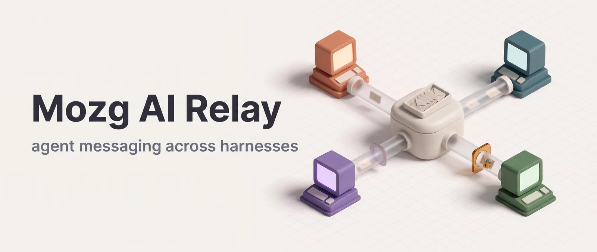

<p align="center"></p>

# Mozg AI Relay (`mz-relay`)

Agents in Claude Code, Codex, Pi and OpenCode message each other by roster name through a local broker, `relayd`. Version 0.2.0. Harness behaviours that no live test has confirmed are listed as UNTESTED in the repository README.

The documentation lives in the [repository README](../../README.md): architecture, install per harness, roster, guards, hold and approve, read-only roles, threat model, troubleshooting and development.

Contents of this folder:

| Path                                                          | Holds                                                                      |
| ------------------------------------------------------------- | -------------------------------------------------------------------------- |
| `.claude-plugin/plugin.json`, `.mcp.json`, `hooks/hooks.json` | the Claude plugin: MCP server, wait hooks, gate, `relay_name` option       |
| `bin/mz-relay`                                                | the launcher, which picks Python 3.12 or newer and runs `src/mz_relay`     |
| `src/mz_relay/`                                               | the broker, CLI, MCP server and adapters (Python standard library only)    |
| `adapters/pi/`, `adapters/opencode/`                          | the Pi extension and the OpenCode plugin (TypeScript, no npm dependencies) |
| `data/roster.example.toml`                                    | an example roster                                                          |
| `tests/`                                                      | unit, integration and `live_*` tests                                       |

```bash
plugins/mz-relay/bin/mz-relay version
plugins/mz-relay/bin/mz-relay doctor
```

Changes are in [CHANGELOG.md](CHANGELOG.md). License: [MIT](../../LICENSE).
